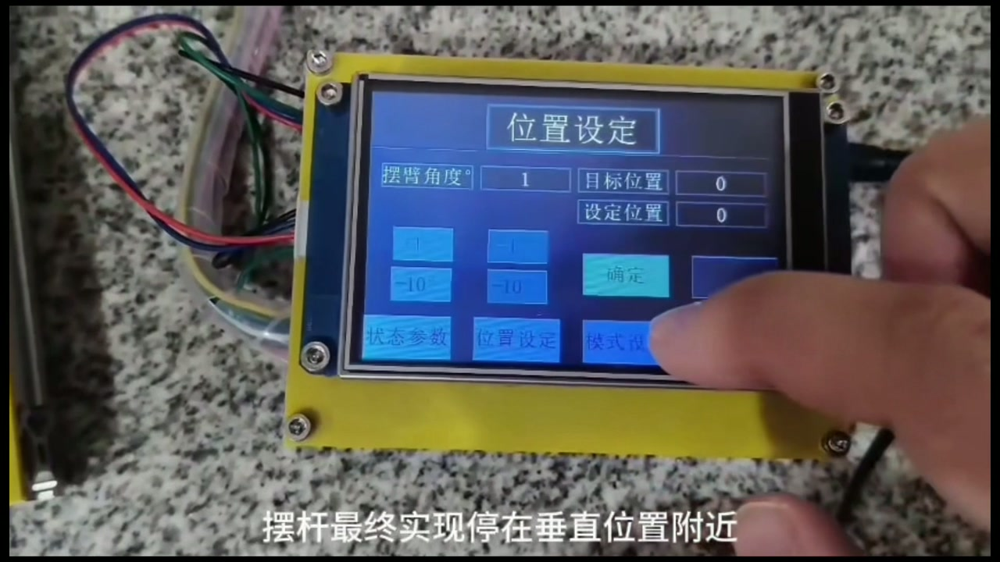

# InvPendGW | FPGA Real-Time Attitude Control

基于高云 `GW2A-LV55` FPGA 的旋转倒立摆实时姿态控制系统。项目以纯 RTL 完成传感器采集、状态估计、自动起摆、直立捕获、双环控制、电机驱动、安全保护及串口触摸屏交互，不依赖 MCU 参与实时闭环。

> **获奖**：2026 年[全国大学生嵌入式芯片与系统设计竞赛](https://www.socchina.net/) FPGA 创新设计赛道全国三等奖
>
> **赛题**：高云半导体赛题 1 - 实时姿态控制系统

[](media/project-demo.mp4)

点击上图播放项目演示视频。仓库内为适合在线预览的压缩版本；原始 1080p 成片未纳入版本控制。

## 项目功能

- 自动起摆、直立捕获和动态平衡
- 摆臂目标位置调节与正弦轨迹运动
- 摆杆环及摆臂环参数在线调节
- 陶晶驰串口触摸屏模式控制、参数设置和状态显示
- 角度、位置、控制量和故障状态遥测
- 摆杆失稳、采样超时、运动边界及人工停止等安全保护
- RTL 仿真、Gowin 综合、布局布线和时序约束的完整工程

## 系统架构

```text
角位移传感器 -> ADC ----------+
                               |
电机编码器 -> AB 相译码 ------+-> 状态估计 -> 控制状态机
                                            |  自动起摆
串口触摸屏 <-> UART ------------------------|  直立捕获
                                            |  姿态/位置双环
                                            v
                                      限幅与安全门控
                                            |
                                            v
                                      PWM + TB6612
                                            |
                                            v
                                     旋转倒立摆机构
```

FPGA 以固定控制节拍组织采样、状态更新、控制运算和输出更新。编码器计数、UART 收发、界面刷新和安全监测并行执行，避免人机交互影响实时闭环。

## 硬件平台

| 模块 | 说明 |
|---|---|
| FPGA | Gowin `GW2A-LV55PG484C8/I7` (`GW2A-55C`) |
| 开发平台 | J280 姿态控制系统开发平台 |
| 姿态反馈 | 角位移传感器 + 10 位并行 ADC |
| 摆臂反馈 | 直流减速电机 AB 相编码器 |
| 电机驱动 | TB6612FNG 双 H 桥驱动器 |
| 人机交互 | 陶晶驰串口触摸屏，UART `115200 8N1` |
| 系统时钟 | 50 MHz |
| HDL | Verilog / SystemVerilog 2017 |

## RTL 组成

| 文件 | 功能 |
|---|---|
| `FPGA/src/main.v` | 顶层、控制状态机、自动起摆、控制协调及安全逻辑 |
| `FPGA/src/adc.v` | ADC 采样与输入处理 |
| `FPGA/src/encoder.v` | AB 相编码器译码与位置计数 |
| `FPGA/src/state_q16.v` | Q16 定点状态换算 |
| `FPGA/src/pid_controller_q16.sv` | 定点 PID 控制器 |
| `FPGA/src/arm_position_trajectory.v` | 摆臂位置参考与限速轨迹 |
| `FPGA/src/arm_sine_reference.v` | 正弦运动参考生成 |
| `FPGA/src/motor_ctrl.v` | 电机方向、制动和 PWM 输出 |
| `FPGA/src/hmi_command_parser.v` | 串口屏命令解析与参数更新 |
| `FPGA/src/hmi_display*.v` | 串口屏状态和参数刷新 |
| `FPGA/src/telemetry_3ms.v` | 实时遥测帧生成 |
| `FPGA/src/uart_*.v` | UART 收发 |

## 仓库结构

```text
FPGA/
  Attitude_Control.gprj   Gowin EDA 工程
  build_gowin.tcl         可复现的命令行构建脚本
  timing.sdc              50 MHz 时序约束
  src/                    RTL 源码与引脚约束
  sim/                    关键模块测试平台
HMI/
  HMI_Interface.HMI       串口触摸屏工程
media/
  demo-cover.jpg          README 演示封面
  project-demo.mp4        项目演示视频（压缩版）
```

综合、布局布线、仿真缓存和编程文件属于生成产物，未纳入版本控制。

## 构建工程

### Gowin EDA 图形界面

使用 Gowin EDA 打开：

```text
FPGA/Attitude_Control.gprj
```

### 命令行构建

安装 Gowin EDA，并确保 `gw_sh` 可用。在 `FPGA` 目录执行：

```powershell
gw_sh build_gowin.tcl
```

脚本会创建已被 `.gitignore` 排除的 `FPGA/build/` 目录。成功完成综合、布局布线和时序分析后，编程文件位于生成的实现目录中。

> Windows 下建议将仓库和 Gowin EDA 放在仅包含 ASCII 字符的路径中。部分 Gowin 工具版本无法通过含非 ASCII 字符的路径读取工程或器件文件。

## 仿真

`FPGA/sim/` 包含以下测试平台：

- `tb_hmi_command_parser.v`：模式、位置、正弦轨迹和 PID 参数命令解析
- `tb_arm_sine_reference.v`：正弦参考、暂停/恢复和安全边界
- `tb_main_gains.v`：运行时控制增益更新

这些测试平台用于验证关键数字逻辑；倒立摆的最终控制效果仍需结合实际机械、电气和传感器系统上板验证。

## 操作概览

1. 连接角位移传感器、编码器、电机驱动和串口触摸屏。
2. 使用 Gowin Programmer 将构建生成的配置文件写入 FPGA。
3. 上电后确认机构处于安全范围，传感器和编码器状态正常。
4. 通过板载按键或串口屏选择自动起摆/停止等模式。
5. 捕获直立状态后，可设置摆臂目标位置、启动正弦轨迹或调整控制参数。
6. 出现姿态失稳、反馈异常或其他故障时，安全逻辑撤销驱动许可；排查原因后再复位运行。

机械系统运行时具有快速旋转部件。调试前应固定底座、整理线束、限制人员进入摆臂范围，并保留可立即断电的操作路径。

## 复现说明

- 顶层模块：`main`
- 目标器件：`GW2A-LV55PG484C8/I7`
- 器件版本：`C`
- 时钟约束：50 MHz
- HDL 标准：SystemVerilog 2017
- 运行时参数修改为易失设置，FPGA 复位或掉电后恢复源码默认值
- HMI 使用独立 UART 接口，具体引脚见 `FPGA/src/pin.cst`
- 位流未提交，请使用仓库中的脚本从源码重新构建

## 项目状态

本仓库是竞赛结束后的项目归档版本，保留可复现 FPGA 工程、HMI 工程、仿真测试和演示材料，便于后续学习、复现与改进。
